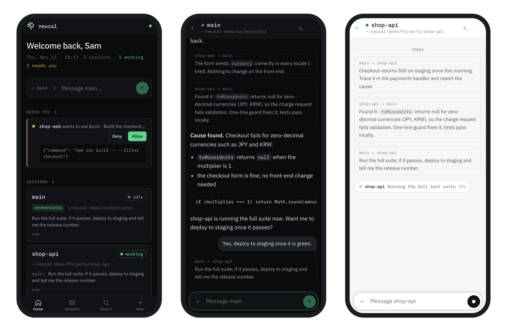
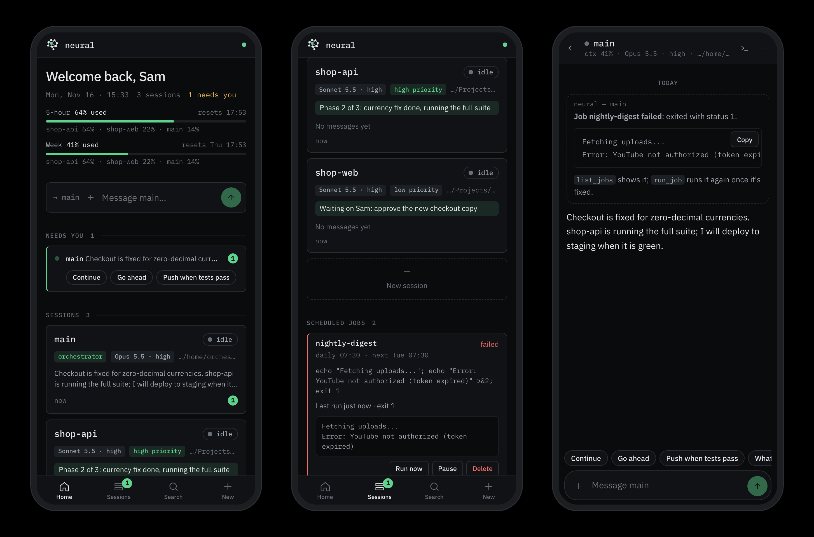
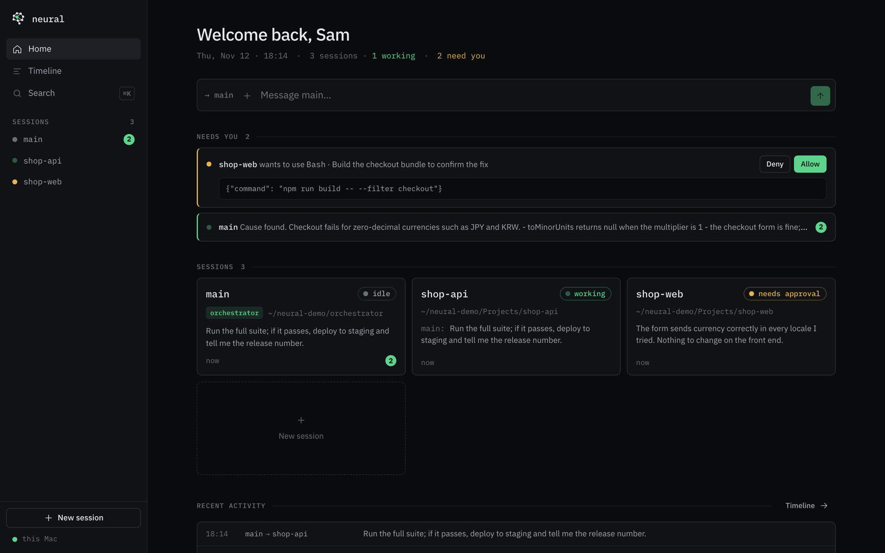
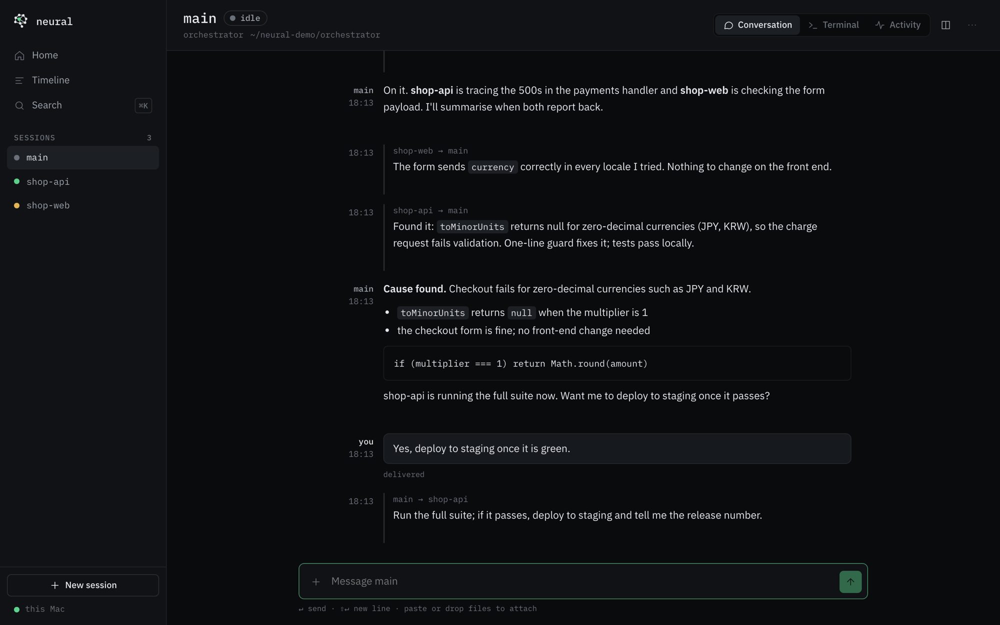
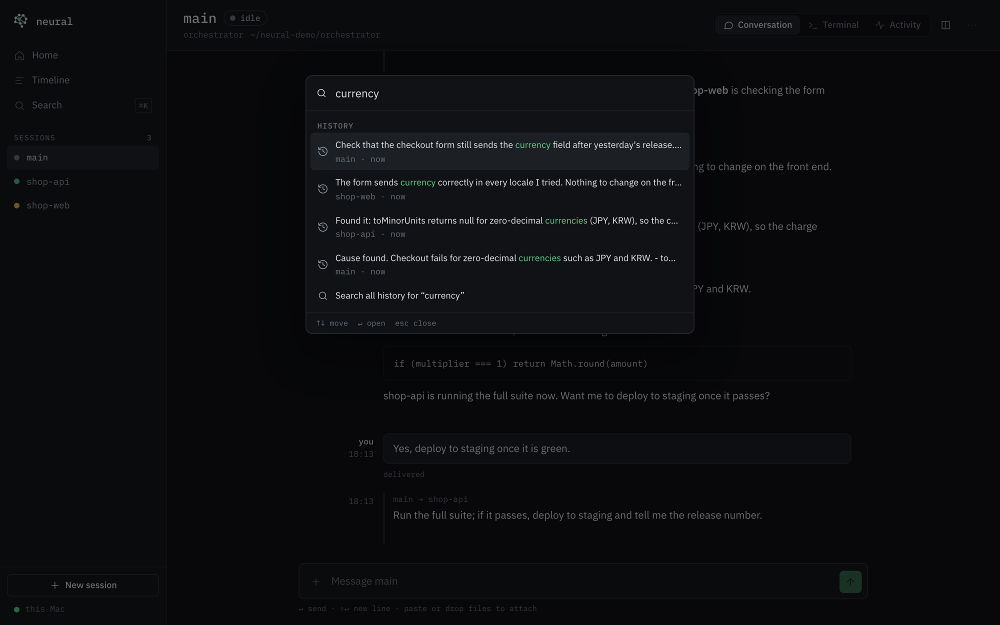
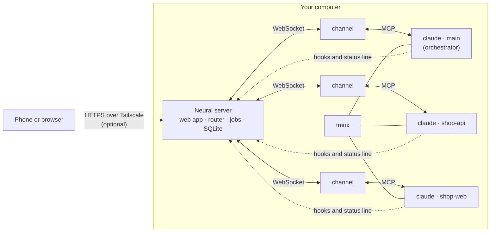

# Neural

**A command center for Claude Code.** Run several Claude Code sessions on your own computer, let one of them
direct the others, and talk to all of them from your phone or browser. Neural keeps them running, keeps a
permanent, searchable memory of everything said, and tells you (or the orchestrator) when something needs
attention.

Free and open source under the [MIT licence](LICENSE). No account, no sign-up, no telemetry: it runs entirely
on your own machine.





## Contents

- [Quick start](#quick-start)
- [Use it from your phone](#use-it-from-your-phone)
- [What it does](#what-it-does)
- [Tools sessions get](#tools-sessions-get)
- [Configuration](#configuration)
- [How it works](#how-it-works)
- [Things to know](#things-to-know)
- [Contributing](#contributing)

## Quick start

**You need:**

- macOS (see [Things to know](#things-to-know) for Linux)
- Node 22.18 or newer
- tmux: `brew install tmux`
- Claude Code, signed in with a claude.ai account or a Console API key (channels need one of these)
- Optional: ffmpeg (`brew install ffmpeg`) to send videos as still frames, and Tailscale for phone access

**Install and run:**

```sh
git clone https://github.com/MKempler/neural.git
cd neural
npm install
bin/neural doctor            # checks Node, tmux, Claude Code and the database
bin/neural start             # web app on http://127.0.0.1:7777
```

The first start launches `main`, the orchestrator, in `~/.local/share/neural/orchestrator`. Open
http://127.0.0.1:7777 and say hello. To keep Neural running:

```sh
bin/neural install-service   # start at login and restart if it stops (launchd)
```

**The command line:**

| Command | What it does |
| :- | :- |
| `bin/neural start` | Run Neural in the foreground |
| `bin/neural status` | List sessions and their state |
| `bin/neural attach <session>` | Open a session's terminal (detach with Ctrl+B, then D) |
| `bin/neural doctor` | Check the installation |
| `bin/neural backup` | Write a database snapshot now |
| `bin/neural install-service` / `uninstall-service` | Add or remove the login service |
| `bin/neural restart` | Restart the login service (rarely needed) |
| `bin/neural notify ...` | Send a message from a script; see [Scripts and jobs](#scheduled-jobs-and-scripts) |
| `bin/neural migrate` | One-off move from an install made before the rename to Neural |

Running as the login service, Neural picks up changes to its own code by itself. A server change is loaded in
a test process first and, if it loads, Neural restarts within seconds while your sessions keep running. Open
pages reload when the web app changes, waiting until you're not typing.

## Use it from your phone

Neural only listens on your computer. The simple, safe way to reach it from a phone is
[Tailscale](https://tailscale.com), a private network between your own devices:

1. Install Tailscale on the computer and the phone, signed in with the same account.
2. Publish Neural on your private network: `tailscale serve --bg 7777`. The first time, the command prints a
   link to enable this.
3. On the phone, open `https://<computer>.<tailnet>.ts.net` in Safari, then Share, **Add to Home Screen**,
   with **Open as Web App** on.
4. Open Neural from the Home Screen and tap **Turn on** on the notifications card.

Neural answers only to `localhost` and Tailscale (`*.ts.net`) names. To keep other people on your tailnet out,
or to use another host name in front of it, see `allowedLogins` and `allowedHosts` under
[Configuration](#configuration).

**Do not expose Neural to the public internet.** Anyone who can reach it can type into your Claude sessions,
which can run commands on your computer.

## What it does



### Work from your phone

- **Home** shows what needs you (approvals, questions, stuck or crashed sessions, unread replies), a card per
  session with its state, model, status note and last message, your usage limits, scheduled jobs and recent
  activity, and a box to message `main`.
- **Conversations** read like a chat: copy and quote on tap, photos, videos and files in both directions, a
  live line showing what the session is doing ("Running the full test suite · 0:33"), Send that turns into
  Stop while it works, drafts per session, and messages that queue while you're offline.
- **Quick replies** above the message box when a session is waiting ("Continue", "Go ahead", "Push when tests
  pass"): tap to send, hold to edit first. The list is shared by every device and suggests what you often send.
- **Approvals, questions and plans** arrive as cards with a notification. Allow or Deny a permission prompt,
  answer Claude's multiple-choice questions, or approve a plan; your answer is typed into the session's
  terminal, checking the screen at each step.
- **Changes:** a session's branch, uncommitted files and recent commits, with diffs that read on a phone.
  Under each reply, a line such as "2 commits · 5 files · +180 −42" says what that turn changed.
- **The live terminal** of any session, which you can type into, side by side with the conversation on a
  wide screen.
- **Slash commands** typed in the chat (`/model sonnet`, `/compact`) run in the session's terminal. Start with
  `//` to send the text to Claude instead.
- **Timeline, Search and a ⌘K palette** across all sessions and history.
- **New session in two taps:** a folder in `~/Projects`, a new project (with git, and a private GitHub
  repository if you tick the box), or a clone of one of your GitHub repositories.

| Conversation | Search and command palette |
| :-: | :-: |
|  |  |

### An orchestrator and its workers

- **`main` directs the others.** It starts sessions in any folder, a new project or a GitHub clone, hands them
  work, reads their terminals and reports back. Sessions message each other through Neural, and a message
  from a session is never treated as your approval.
- **Waiting doesn't make it deaf.** Claude Code shows a session new messages only between tool calls, so
  `wait_for` returns early when you write, and `wait_for(notify: true)` doesn't block at all: Neural messages
  `main` when the session is done.
- **Status notes.** Each session can keep a one-line note ("waiting on Sam: approve the checkout copy",
  "phase 2 of 3: running the suite"), shown on Home and to `main`.
- **Model and effort per session**, passed to Claude Code as `--model` and `--effort` and kept across
  restarts, so routine work can run on a cheaper model. Change them from the session's model sheet or with
  `set_model`.
- **Extra MCP servers per session** (Roblox Studio, a docs server) without touching your Claude Code
  settings, kept across restarts.
- **Priority:** high, normal or low, used when usage gets tight (below).

### It keeps itself healthy

- **Crashes are recovered.** A session that exits is restarted with its conversation resumed, backing off
  between attempts and giving up after five in a row. One that died before its first prompt starts afresh and
  still gets that prompt.
- **Causes, not just symptoms.** Before every start Neural checks that Claude Code runs (`claude --version`).
  If the install is broken, it says what is wrong and how to fix it, spends no restart attempts, and starts the
  waiting sessions again once Claude Code works. The app shows why a session is down and whether Neural is
  retrying.
- **`main` is told.** One short message when a session stops unexpectedly, crashes again, gets stuck or needs
  attention, when Neural gives up, and when it is healthy again, so `main` can fix it and tell you only when it
  can't. You get a push notification when `main` itself goes down.
- **Startup prompts are answered.** Claude Code asks for confirmation on launch; Neural answers, and picks a
  stuck startup back up within seconds.
- **Updates reach running sessions.** A session started before Neural's hooks, status line or channel server
  changed is restarted once it has been idle for 3 minutes, with nothing queued, no question open, nobody in
  its terminal and no background shell or task running. Its conversation is resumed.
- **A fresh context instead of a lossy summary.** When `main`'s context passes 60% or 150K tokens, Neural asks it to update
  `STATE.md`, its operations ledger, then restarts it fresh (not resumed) once it has and is idle, so it
  starts from its instructions and that file instead of Claude Code's compacted summary. Workers can opt in,
  and "Fresh context" in a session's menu does it by hand.

### Usage limits

- **Meters on Home** for the 5-hour and weekly limits, with when each resets and which sessions used how much
  of it (estimated from each session's cost). Each session also shows how full its context window is.
- **`main` is told** when a limit passes 80% and 95%, once per window, with each session's share and the
  low-priority sessions to pause.
- **Low-priority sessions wait.** From 95%, messages from other sessions to low-priority ones are held until
  the limit resets. Yours always go through.
- **Limits are handled.** A session at its limit shows **usage limit** with the reset time, and messages wait
  rather than fail. When a 5-hour limit resets, a session whose turn was cut off is told to carry on, one
  session a minute with `main` first. Weekly limits are left for you to restart.

### Scheduled jobs and scripts

Sessions schedule recurring work with `add_job`: a shell command, or a prompt to a session, on a schedule
such as `every 30m`, `daily 08:00`, `weekdays 09:30`, `mon,thu 18:00` or cron (`0 8 * * 1-5`). Neural:

- runs commands with your login shell's PATH, so `claude`, `node` and Homebrew tools are found (a common
  reason launchd jobs fail),
- keeps each run's output, and lists jobs on Home and in Sessions with Run now, Pause and Delete,
- tells `main` when a job fails, again with a push notification after 3 failures in a row, and when it works
  again.

Anything else on the machine can send a message with the command line:

```sh
bin/neural notify --to user --from nightly-digest "Digest failed: YouTube not authorized"
some-command 2>&1 | bin/neural notify --to main --from pipeline --file /tmp/run.log -
```

`--to user` sends a push notification; `--to <session>` delivers it to that session as `from="job:<name>"`.
It uses the secret in Neural's data folder. `POST /api/notify` with `Authorization: Bearer <secret>` and JSON
`{to, from, text, files}` does the same.

### Memory and privacy

- **Nothing is forgotten.** Every message, and every Claude Code transcript on the machine, goes into a local
  database, searchable by keyword and by meaning (a small local model). Transcripts stay searchable after
  Claude Code's own cleanup.
- **Secrets are kept out of the archive.** Tokens and keys in known formats (Anthropic, OpenAI, GitHub,
  GitLab, Hugging Face, AWS, Google, Slack, Stripe, npm), private keys, JWTs, passwords in URLs and long
  `password=` / `api_key:` values are replaced with "[redacted ...]" in stored messages, transcripts, search
  and logs. A session you send a token to still receives it as written.
- **Daily backups** of the database, rotated.
- **Your data stays home.** Conversations, uploads, indexes and backups live in `~/.local/share/neural`.
  Neural sends nothing anywhere; your sessions talk to Anthropic exactly as Claude Code always does.

## Tools sessions get

Neural gives each session its tools through a small MCP server, the channel.

| Who | Tools |
| :- | :- |
| Every session | `reply`, `send_message`, `list_sessions`, `search_history`, `get_thread`, `set_status`, `add_job`, `list_jobs`, `run_job`, `pause_job`, `remove_job` |
| The orchestrator also | `spawn_session` (with `template`, `model`, `effort`, `priority`, `mcp_servers`, `fresh_context`, `new_project`, `clone`, `worktree`), `stop_session`, `restart_session`, `read_screen`, `wait_for`, `set_model`, `set_priority`, `set_mcp_servers`, `fresh_context`, `list_templates`, `set_template` |

The orchestrator's instructions live in [orchestrator/CLAUDE.md](orchestrator/CLAUDE.md). Neural copies them
into `main`'s folder and keeps that copy up to date unless you edit it; it never touches `STATE.md`.

## Configuration

Everything is optional. Settings go in `~/.local/share/neural/config.json`; environment variables override
it (the older `HUB_` names still work).

```json
{
  "displayName": "Sam",
  "allowedLogins": ["you@example.com"],
  "allowedHosts": ["neural.example.com"],
  "projectsRoot": "~/Code",
  "autoContinue": true,
  "autoRefresh": true,
  "quotaHold": true,
  "handoffAt": 60
}
```

| `config.json` | Environment | Default | Meaning |
| :- | :- | :- | :- |
| `displayName` | `NEURAL_DISPLAY_NAME` | none | Name in the greeting |
| `allowedLogins` | `NEURAL_ALLOWED_LOGINS` | anyone on your tailnet | Tailscale logins allowed to use the app (comma-separated in the environment) |
| `allowedHosts` | `NEURAL_ALLOWED_HOSTS` | none | Extra host names Neural answers to, besides localhost and `*.ts.net` |
| `projectsRoot` | `NEURAL_PROJECTS_ROOT` | `~/Projects` | Where new projects are created and cloned, and whose folders New session lists |
| `autoContinue` | `NEURAL_AUTO_CONTINUE` | on | Tell a session to carry on when its usage limit resets (`off` in the environment) |
| `autoRefresh` | `NEURAL_AUTO_REFRESH` | on | Restart idle sessions started with an older Neural setup |
| `quotaHold` | `NEURAL_QUOTA_HOLD` | on | From 95% of a limit, hold messages from other sessions to low-priority ones |
| `handoffAt` | `NEURAL_HANDOFF_AT` | `60` | Context percent for the fresh-context handoff (`0` turns it off) |

Environment only:

| Variable | Default | Meaning |
| :- | :- | :- |
| `NEURAL_PORT` | `7777` | Port for the web app and API |
| `NEURAL_DATA_DIR` | `~/.local/share/neural` | Database, uploads, backups and per-session files |
| `NEURAL_ORCHESTRATOR_CWD` | `<data dir>/orchestrator` | Working folder of `main` |
| `NEURAL_CLAUDE_BIN` | `claude` | Path to Claude Code |
| `NEURAL_AUTOSTART` | on | `0` stops Neural starting `main` and restarting dead sessions |
| `NEURAL_AUTO_RELOAD` | on | `off` stops restarting on code changes and reloading open pages |
| `NEURAL_ACK_TIMEOUT` | `90` | Seconds before an unread push is typed into the terminal instead |
| `NEURAL_MAX_UPLOAD_MB` | `1024` | Largest file you can attach |
| `NEURAL_EMBEDDINGS` | on | `off` for keyword-only search |
| `NEURAL_BACKUPS` | on | `off` stops daily snapshots |
| `NEURAL_BACKUP_DIR` | `<data dir>/backups` | Where snapshots go; point it at a synced folder for off-machine copies |
| `NEURAL_BACKUP_KEEP` | `7` | How many snapshots to keep |
| `NEURAL_KEEP_AWAKE` | on | `off` lets the Mac sleep while sessions work |
| `NEURAL_TRANSCRIPTS_DIR` | `~/.claude/projects` | Claude Code transcripts to archive |
| `NEURAL_TMUX_SOCKET` | `neural` | tmux server Neural uses (`tmux -L neural`), separate from your own |

## How it works



- Each session is an ordinary interactive `claude` process in its own tmux window, so you can always attach
  to it, and closing a terminal doesn't stop it.
- Neural starts each session with the **channel**, an MCP server that pushes your messages into the session
  and gives Claude its tools. Messages are pushed, never polled.
- Claude Code **hooks** report each session's state (working, waiting, finished, the tool in use), and its
  **status line** reports context and usage.
- Nothing is added to your global Claude Code settings: the channel, hooks, status line, model and extra MCP
  servers are passed on each session's command line.

| Path | Normally | If that fails |
| :- | :- | :- |
| You to a session | Pushed through the channel | Queued while the session is down; a push with no sign of being read is typed into the terminal instead |
| Session to you | The `reply` tool | The turn's final text is captured by a hook and shown, marked "from the terminal" |
| Session to session | `send_message`, routed through Neural | Queued until the other session is ready |
| Permission prompts | Allow / Deny in the app | Answer in the terminal view |

## Things to know

- **Channels are a research preview.** Custom channels aren't on Anthropic's allowlist yet, so sessions start
  with Claude Code's `--dangerously-load-development-channels` flag, and Neural answers the confirmation it
  shows. If a future Claude Code changes that prompt, the session shows **Needs attention** and you can
  answer it from the terminal view.
- **Sessions use auto mode** (`--permission-mode auto`). Anything auto mode escalates shows up as an
  Allow/Deny card.
- **Usage adds up.** Every session uses your plan or API key independently, so start only what you need.
- **The status line is Neural's.** Sessions show "context 41% · 5-hour 62% (resets 20:20) · week 41%". A
  status line you set up yourself still shows instead. Numbers appear after a session's first reply, and the
  limits only on a claude.ai plan.
- **Redaction has limits.** Backups made before a secret was redacted keep it until they age out, Claude
  Code's own transcripts in `~/.claude/projects` are untouched, and an unusual secret can get through, so
  rotate anything you've pasted.
- **macOS today.** The core should work on Linux, but the login service (launchd), photo conversion (`sips`)
  and keep-awake (`caffeinate`) are Mac-specific. Linux support is a welcome contribution.
- Neural is an independent project, not affiliated with or endorsed by Anthropic. Claude and Claude Code are
  trademarks of Anthropic.

## Contributing

Issues, ideas and pull requests are welcome. Open an issue first for anything large, so we can agree on the
approach. There is no build step: the web app is plain JavaScript modules (Preact and htm) and the server
runs TypeScript directly on Node.

```sh
npm install
npm test
```

The tests run the real server, tmux and channel against `test/fake-claude.ts`, a scripted stand-in for
Claude Code that speaks MCP and posts hooks, so they cost no Claude usage.

Good first contributions: Linux support (a systemd service and a `sips` replacement), voice notes
transcribed locally, a herdr or Zellij backend behind the `Mux` interface, and tests for the web app.

```
server/src/index.ts       HTTP, WebSockets, hook endpoint, static files
server/src/router.ts      store-then-deliver, acknowledgements, fallbacks, session tools
server/src/spawner.ts     launching sessions, startup prompts, crash recovery, refreshes
server/src/health.ts      why a session is down, checking Claude Code runs, notices to the orchestrator
server/src/handoff.ts     fresh-context handoffs (STATE.md)
server/src/jobs.ts        scheduled jobs: schedules, runs, failure reports
server/src/usage.ts       usage limits, context and the quota guard, from each session's status line
server/src/ingest.ts      transcript archive
server/src/embed.ts       meaning-based search (local model + sqlite-vec)
server/src/git.ts         a session's changes and turn recaps (read-only)
server/src/projects.ts    project folders: list, create (git, GitHub) and clone
server/src/dialogs.ts     answering Claude Code's question and plan dialogs by keys
server/src/redact.ts      keeping secrets out of the archive (and scrub.ts, the one-off clean-up)
server/src/files.ts       attachments: storage, photo conversion, video stills
server/src/push.ts        Web Push notifications
server/src/terminal.ts    live terminal in the browser
server/src/mux/           terminal multiplexer interface and the tmux backend
channel/neural-channel.ts the channel MCP server each session runs
channel/statusline.sh     the status line each session runs, which reports to Neural
web/src, web/styles       the web app
orchestrator/CLAUDE.md    instructions for the orchestrator
db/migrations/            database schema
bin/neural                command line
```

## Licence

MIT. See [LICENSE](LICENSE). Free for anyone to use, modify and share.
