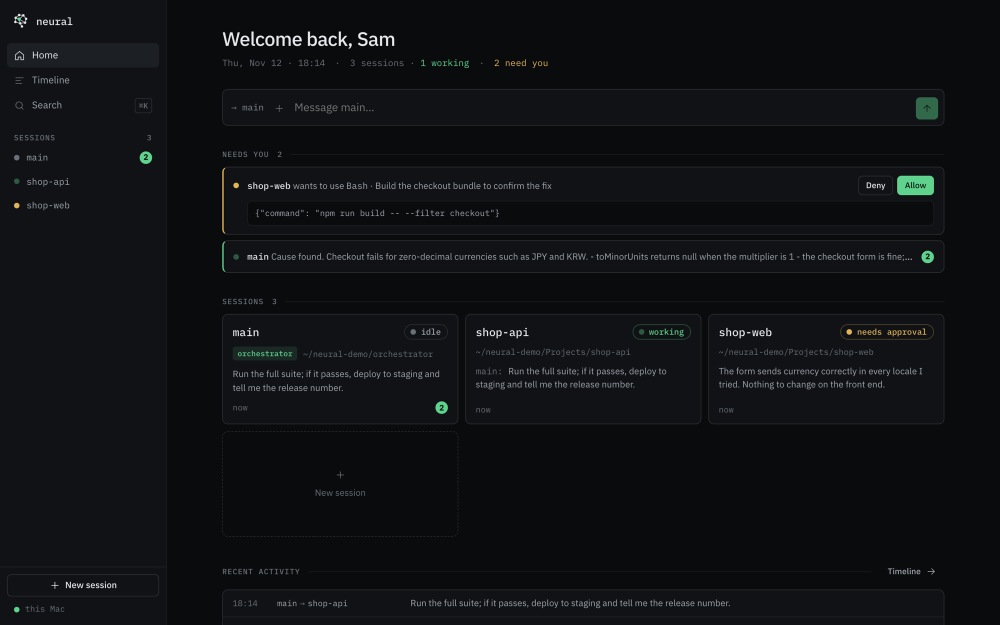
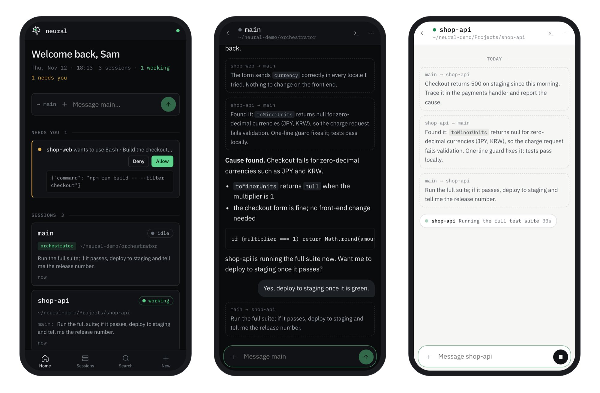
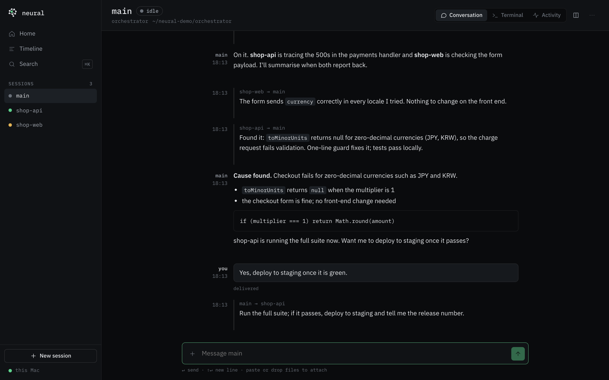
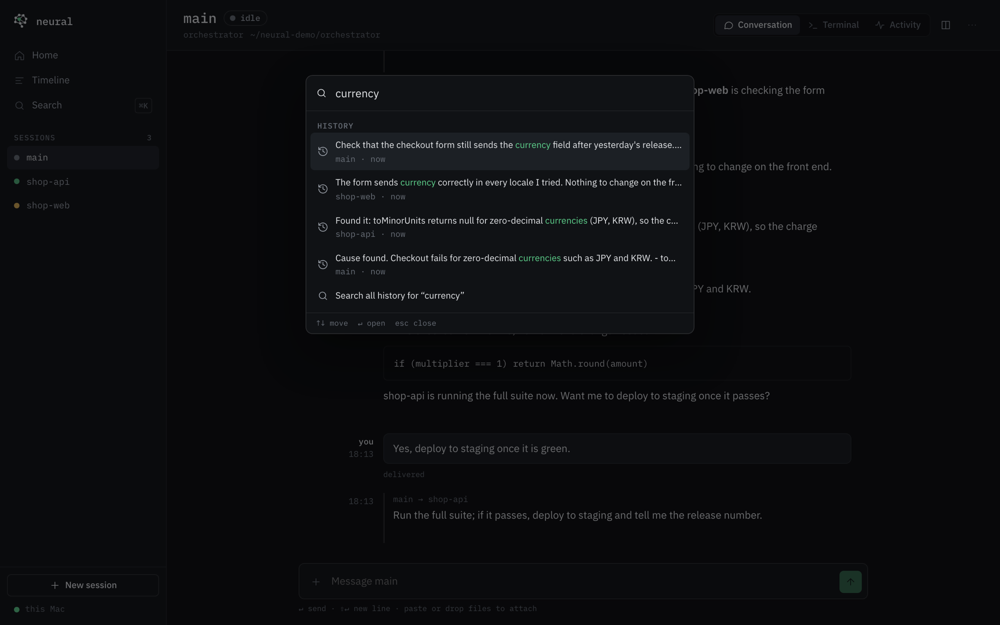
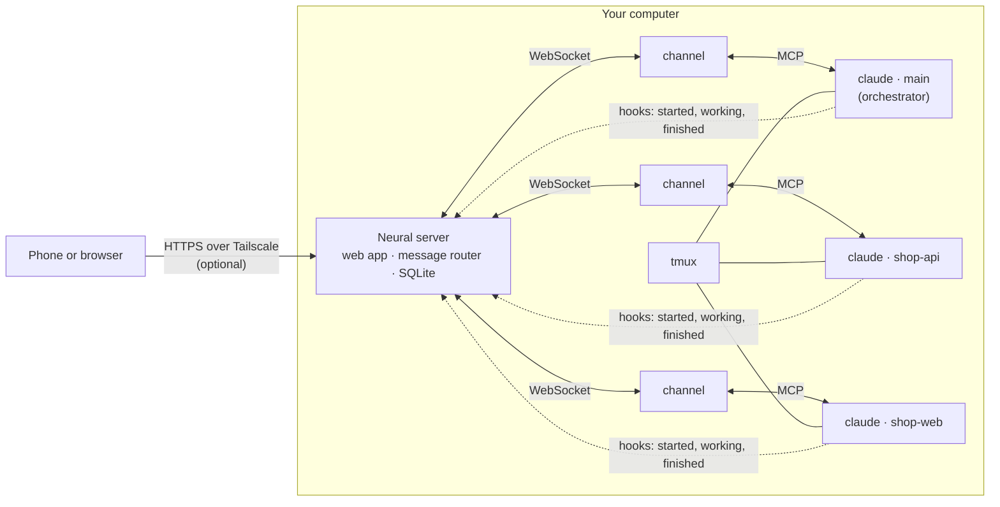

# Neural

**A command center for Claude Code.** Run several Claude Code sessions on your own computer, let one of them
direct the others, and talk to all of them from your browser or your phone, with a permanent, searchable
memory of everything that was said.

**Neural is free and open source under the [MIT licence](LICENSE).** Anyone can use it, change it, self-host
it or build on it, for personal or commercial work, with no sign-up, no account and no telemetry. It runs
entirely on your own machine.





## Why Neural

Claude Code is at its best when you give it focused jobs, but juggling several terminals gets old quickly,
and stepping away from the desk means losing touch with all of them. Neural turns those sessions into one
place you can work from anywhere:

- **One orchestrator, many workers.** A session called `main` can start new sessions in any folder, hand
  them work, read their terminals, wait for them to finish and report back to you.
- **Messages are pushed, never polled.** What you type in Neural arrives in the session straight away
  through Claude Code [channels](https://code.claude.com/docs/en/channels-reference). Sessions can message
  each other the same way.
- **Your phone is a first-class client.** Neural installs as a home-screen app, with push notifications,
  approve/deny buttons for permission prompts, photos and videos, and a live terminal you can type into.
- **Nothing is forgotten.** Every message, and every Claude Code transcript on the machine, goes into a
  local database. Sessions can search it by keyword or by meaning when they need something from last week.
- **It keeps itself running.** Crashed sessions resume their conversations, undelivered messages are
  retried, the server starts at login, and the database is backed up daily.

## Open source, for anyone

- **Licence:** [MIT](LICENSE). Use it at home or at work, fork it, sell something built on it. The only
  condition is keeping the copyright and licence notice with copies of the code.
- **Your machine, your data:** the server listens on your computer only. Conversations, uploads, search
  indexes and backups live in `~/.local/share/neural`. Neural itself sends nothing anywhere; your sessions
  talk to Anthropic exactly as Claude Code always does.
- **No build step:** the web app is plain JavaScript modules (Preact and htm) loaded straight from
  `node_modules`, and the server runs TypeScript directly on Node. Reading or changing the code needs no
  toolchain.
- **Contributions welcome:** issues, ideas and pull requests are all appreciated. See
  [Contributing](#contributing).

Neural is an independent project. It is not affiliated with or endorsed by Anthropic. Claude and Claude Code
are trademarks of Anthropic.

## What it looks like

| Conversation | Search and command palette |
| :-: | :-: |
|  |  |

- **Home:** what needs you (approvals, stuck sessions, unread replies), a card per session with its state
  and last message, recent activity across sessions, and a box to message `main`.
- **Session:** the conversation, the live terminal and an activity log of what the session did. On a wide
  screen the conversation and terminal can sit side by side.
- **On the phone:**
  - chat-style messages, with copy and quote on tap
  - a composer with + for camera, photos and files, and Send that turns into Stop while the session works
  - a live line showing what the session is doing ("Running the full test suite · 0:33")
  - drafts kept per session, and messages that queue while you're offline
- **Timeline** of every message, **Search** across all history, and a **⌘K** palette to jump anywhere.
- **Slash commands from the chat:** a message starting with `/` (`/model sonnet`, `/effort max`, `/compact`)
  runs in the session's terminal, as if typed into Claude Code. Start with `//` to send it to Claude as text.
- **Model and effort** are shown on every session ("Fable 5.2 · high"); tap them to change.

## How it works



- Each session is an ordinary interactive `claude` process in its own tmux window, so closing your terminal
  doesn't stop it and you can always attach to it.
- Neural starts each session with a small MCP server, the **channel**, which pushes your messages into the
  session and gives Claude its tools (`reply`, `send_message`, `search_history` and so on).
- Claude Code **hooks** report each session's state back: working, waiting for approval, finished, or what
  tool it is using right now.
- Nothing is added to your global Claude Code settings. The channel and hooks are passed to each session on
  its command line.

### How a message travels

| Path | Normally | If that fails |
| :- | :- | :- |
| You to a session | Pushed through the channel | Queued while the session is down. If a push shows no sign of being read, it is typed into the terminal instead. |
| Session to you | The `reply` tool | The final text of the turn is captured by a hook and shown, marked "from the terminal". |
| Session to session | `send_message`, routed through Neural | Queued until the other session is ready. |
| Permission prompts | Allow / Deny in the app | Answer in the terminal view. |

A session that crashes, or that was running before a reboot, is resumed with `claude --resume` and keeps its
conversation. A session you stop stays stopped.

### Tools a session gets

- **Every session:** `reply`, `send_message`, `list_sessions`, `search_history`, `get_thread`.
- **The orchestrator also gets:** `spawn_session`, `stop_session`, `restart_session`, `read_screen`,
  `wait_for`.

## Get started

### Requirements

- **macOS.** Neural is built and tested on macOS. The core should work on Linux too, but the login service
  (launchd), photo conversion (`sips`) and keep-awake (`caffeinate`) are Mac-specific. Linux support is a
  welcome contribution.
- **Node 22.18 or newer.**
- **tmux:** `brew install tmux`.
- **Claude Code**, signed in with a claude.ai account or a Console API key. Channels need one of these.
- **Optional:**
  - ffmpeg, to send videos to sessions as still frames (`brew install ffmpeg`)
  - Tailscale, for phone access

### Install and run

```sh
git clone https://github.com/MKempler/neural.git
cd neural
npm install
bin/neural doctor     # checks everything is in place
bin/neural start      # web app on http://127.0.0.1:7777
```

The first start launches `main` in `~/.local/share/neural/orchestrator`. Open http://127.0.0.1:7777 and say
hello.

```sh
bin/neural status            # sessions and their state
bin/neural attach main       # open a session's terminal; detach with Ctrl+B then D
bin/neural install-service   # start Neural at login and keep it running
bin/neural backup            # write a database snapshot now
bin/neural restart           # restart the login service (rarely needed, see below)
```

When Neural runs as the login service it picks up changes to its own code by itself. A server change is
loaded in a test process first and, if it loads, Neural restarts within a couple of seconds; your sessions
keep running and reconnect. A broken change is logged and the running version stays up. Open pages and the
phone app reload when the web app changes, waiting until you're not typing. Set `NEURAL_AUTO_RELOAD=off` to
turn this off.

To show your name in the greeting, add `"displayName": "Your name"` to `~/.local/share/neural/config.json`.

### Use it from your phone

Neural only listens on your computer. The easiest safe way to reach it from a phone is
[Tailscale](https://tailscale.com), a private network between your own devices:

1. Install Tailscale on your computer and your phone, and sign in on both with the same account.
2. Publish Neural to your private network: `tailscale serve --bg 7777`. The first time, the command prints a
   link to enable this for your network.
3. On the phone, open `https://<your-computer>.<your-tailnet>.ts.net` in Safari, then tap Share, **Add to
   Home Screen**. Keep **Open as Web App** switched on.
4. Open Neural from the Home Screen and tap **Turn on** on the notifications card.

To keep other people on your Tailscale network out, list the logins allowed to use Neural in
`~/.local/share/neural/config.json`: `{"allowedLogins": ["you@example.com"]}`.

**Do not expose Neural to the public internet.** Anyone who can reach it can type into your Claude sessions,
which can run commands on your computer.

## Things to know

- **Channels are a research preview.** Custom channels aren't on Anthropic's allowlist yet, so sessions start
  with Claude Code's `--dangerously-load-development-channels` flag. Claude Code shows a confirmation for it
  on every launch, and Neural answers it for you. If a future Claude Code version changes that prompt, a
  session shows **Needs attention** and you can answer it from the terminal view.
- **Sessions use auto mode.** Spawned sessions run with `--permission-mode auto`. Anything auto mode
  escalates shows up as an Allow/Deny card.
- **Usage adds up.** Every session uses your Claude plan or API key independently, so start only what you
  need.
- **Transcripts are archived.** Neural copies every Claude Code transcript on the machine into its
  database, so they stay searchable after Claude Code's own cleanup.

## Configuration

Everything is optional. Environment variables override `~/.local/share/neural/config.json`, and the older
`HUB_` names still work.

| Variable | Default | Meaning |
| :- | :- | :- |
| `NEURAL_PORT` | `7777` | Port for the web app and API |
| `NEURAL_DATA_DIR` | `~/.local/share/neural` | Database, uploads, backups and per-session files |
| `NEURAL_ORCHESTRATOR_CWD` | `<data dir>/orchestrator` | Working folder of `main` |
| `NEURAL_CLAUDE_BIN` | `claude` | Path to the Claude Code binary |
| `NEURAL_DISPLAY_NAME` | from `config.json` | Name in the greeting |
| `NEURAL_ALLOWED_LOGINS` | from `config.json` | Comma-separated Tailscale logins allowed to use the app |
| `NEURAL_AUTOSTART` | on | `0` stops Neural starting `main` and restarting dead sessions |
| `NEURAL_MAX_UPLOAD_MB` | `1024` | Largest file you can attach |
| `NEURAL_EMBEDDINGS` | on | `off` for keyword-only search |
| `NEURAL_BACKUP_DIR` | `<data dir>/backups` | Where daily snapshots go; point it at a synced folder for off-machine copies |
| `NEURAL_BACKUP_KEEP` | `7` | How many snapshots to keep |
| `NEURAL_KEEP_AWAKE` | on | `off` lets the Mac sleep while sessions work |
| `NEURAL_TRANSCRIPTS_DIR` | `~/.claude/projects` | Transcripts to archive |
| `NEURAL_AUTO_RELOAD` | on | `off` stops restarting on code changes and reloading open pages |
| `NEURAL_ACK_TIMEOUT` | `90` | Seconds before an unread push is typed into the terminal instead |

Moving from an install made before the rename to Neural? Run `bin/neural migrate` once. It moves
`~/.local/share/claude-hub` and the login service over, and resumes your sessions.

## Contributing

Pull requests, bug reports and ideas are welcome. Open an issue first for anything large, so we can agree on
the approach.

```sh
npm install
npm test
```

The test suite runs the real server, tmux and channel against `test/fake-claude.ts`, a scripted stand-in
for Claude Code that speaks MCP and posts hooks. So you can test everything without spending any Claude
usage.

Ideas that would make good contributions:

- Linux support: a systemd service, and a `sips` replacement for photo conversion.
- Voice notes recorded in the app and transcribed locally.
- A herdr or Zellij backend behind the `Mux` interface in `server/src/mux/`.
- Wider tests for the web app.

### Project layout

```
server/src/index.ts       HTTP, WebSockets, hook endpoint, static files
server/src/router.ts      store-then-deliver, acknowledgements, fallbacks, session tools
server/src/spawner.ts     launching sessions, startup prompts, crash recovery
server/src/ingest.ts      transcript archive
server/src/embed.ts       meaning-based search (local model + sqlite-vec)
server/src/files.ts       attachments: storage, photo conversion, video stills
server/src/push.ts        Web Push notifications
server/src/terminal.ts    live terminal in the browser
server/src/mux/           terminal multiplexer interface and the tmux backend
channel/neural-channel.ts the channel MCP server Claude Code runs in each session
web/src, web/styles       the web app
orchestrator/CLAUDE.md    instructions given to the orchestrator
db/migrations/            database schema
bin/neural                command line
```

## Licence

MIT. See [LICENSE](LICENSE). Free for anyone to use, modify and share.
